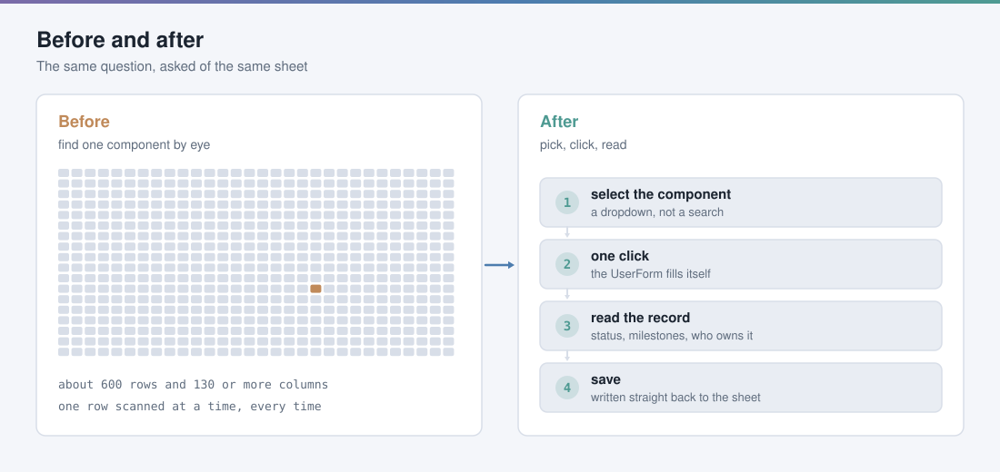
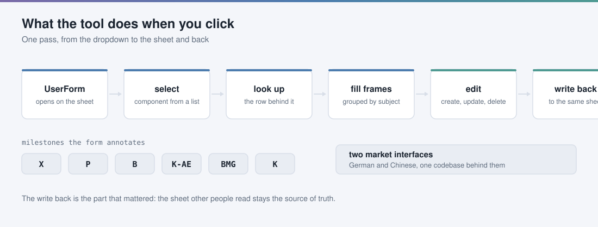
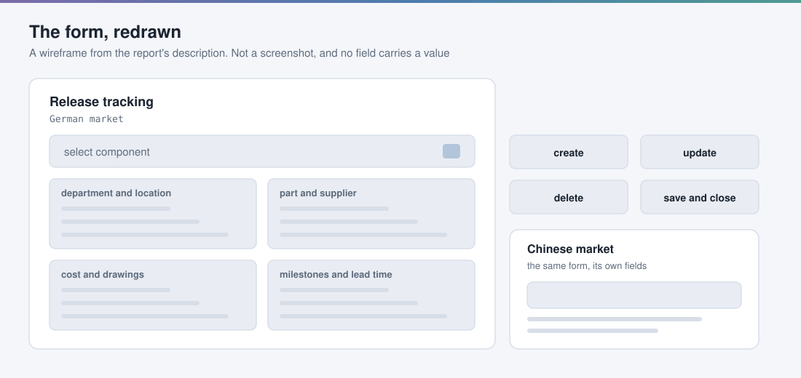
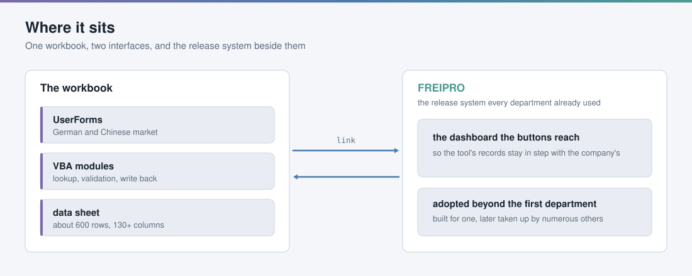

<picture>
  <source media="(prefers-color-scheme: dark)" srcset="docs/figures/01-before-after-dark.svg">
  
</picture>

# Release tracking at AUDI AG, a case study

<!-- project-story:start -->
<p align="center"></p>

| Problem | Why it mattered | Result |
|---|---|---|
| About 600 rows and 130 columns, searched by eye. | People needed one record, again and again. | **4 frames** replaced scanning the sheet, and other departments adopted it |

[See it animated on mzquadri.de](https://mzquadri.de/work/audi-release-tracking)
<!-- project-story:end -->

A development release sheet of roughly **600 rows and 130 or more columns**, and
a question people asked of it many times a day: what is the status of this one
component. The answer was in the sheet. Finding it meant scanning the grid by
eye, every time.

I built an Excel VBA application with UserForms that answered the same question
from a dropdown and one click, kept the sheet itself as the source of truth,
and reached the release system the rest of the company already used. It was
built for one department and was later taken up by others.

This repository is a **case study**, not the tool. There is no AUDI code here,
no internal data, no screenshot of the real interface and nobody's name. What
is here is the problem, the design, and what I learned. Every figure is drawn
by [`tools/make_diagrams.py`](tools/make_diagrams.py) from the description in
my internship report.

---

## The problem

Every department worked against one release system, **FREIPRO**, and one
spreadsheet carried the development release state for the components a
department owned. The sheet was wide: the report records about 600 rows and 130
or more columns, enough that a person looking for one component's status read
across a screen that did not fit on a screen.

Three things made that worse than it sounds.

- **It was a read, not a report.** People wanted one record, and the sheet made
  them look at all of them.
- **It was frequent.** The people doing it were doing it as part of their job,
  repeatedly, not once.
- **It was two markets.** The German and the Chinese market carried different
  fields, so the same question had two shapes.

## What I built

<picture>
  <source media="(prefers-color-scheme: dark)" srcset="docs/figures/02-tool-flow-dark.svg">
  
</picture>

An Excel VBA application, driven from UserForms:

- **A dropdown instead of a search.** Pick the component. The form fills itself
  from the row behind it.
- **Fields grouped into frames**, by subject rather than by column order:
  department and location, part and supplier, cost and drawings, milestones and
  lead time. The sheet's column order is an accident of how the sheet grew; the
  grouping is what a reader actually wants.
- **Create, update and delete**, with the result written straight back to the
  source sheet. The sheet stays the thing other people read.
- **Milestone annotation** on the release data: X, P, B, K-AE, BMG and K, each
  with its own comment.
- **Two interfaces**, one per market, over the same workbook.
- **A link to FREIPRO**, through buttons wired to the dashboard, so the tool's
  view and the company's view did not drift apart.

## The form, redrawn

<picture>
  <source media="(prefers-color-scheme: dark)" srcset="docs/figures/04-ui-wireframe-dark.svg">
  
</picture>

This is a wireframe, not a screenshot. It is drawn from the layout the report
describes, and no field on it carries a value, a part number or a supplier.

## Where it sat

<picture>
  <source media="(prefers-color-scheme: dark)" srcset="docs/figures/03-architecture-dark.svg">
  
</picture>

The whole thing lived in the workbook people already had open. That was the
point: a separate application would have been a second place to look, and the
problem was that there was already one place too many.

## What it changed

| | Before | After |
|---|---|---|
| Finding one component | scan the grid | choose it from a list |
| Reading its state | across 130 or more columns | four frames, grouped by subject |
| Changing it | edit the cell and hope | a form, then an automatic write back |
| Keeping it in step with FREIPRO | by hand | a link |
| Markets | one sheet, two sets of rules in your head | two interfaces |

The report's own summary is that the interface was built for a single
department and was **subsequently enlarged to accommodate numerous
departments**.

## Skills used

`Excel VBA` `UserForm design` `event-driven programming` `data validation`
`CRUD against a spreadsheet` `integration with an existing system`
`requirements gathering` `iterative design with a stakeholder`

## What I learned

**The interface is the smallest part.** Drawing the form took an afternoon.
Deciding which fields belong beside which other fields, and which of the 130
columns nobody actually reads, took the rest of it, and that was the work.

**Write back, or it is a toy.** A read-only viewer would have been easier and
would have been abandoned, because the people reading the sheet were the people
changing it. The moment the form could write, it became the way to work rather
than a nicer way to look.

**Integrating with the thing that already exists is the hard part, and it is
the part that matters.** The report says it plainly: the most difficult piece
was connecting to the main software. A tool that keeps its own copy of the
truth is a second source of truth, which is the problem it was supposed to
solve.

**Iterate with the person who has the problem.** The first version was a
deliberately rudimentary prototype. The design that shipped came out of going
back and forth over it, and several of the best decisions in it were not mine.

## Reproducing the figures

```bash
python tools/make_diagrams.py     # writes docs/figures/*.svg, light and dark
node tools/preview.mjs            # rasterises them to look at, not committed
```

## What is deliberately not here

- No AUDI source code, in any form.
- No internal data, no part numbers, no suppliers, no real field values.
- No screenshots of the real interface.
- No colleagues' names.
- No scan of the internship certificate.

The internship report this is drawn from carries no confidentiality marking. It
is a TUM academic submission with no AUDI classification stamp, and the text was
searched for the usual markings before any of this was written.

---

*Intern, Programming of Workflows and Linking of Databases. The internship was
credited as the Master's Berufspraktikum at TU Munich.*
